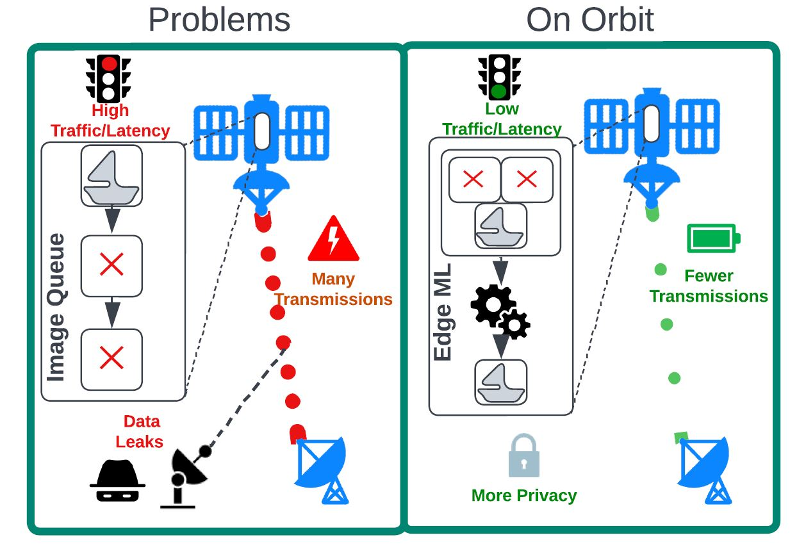
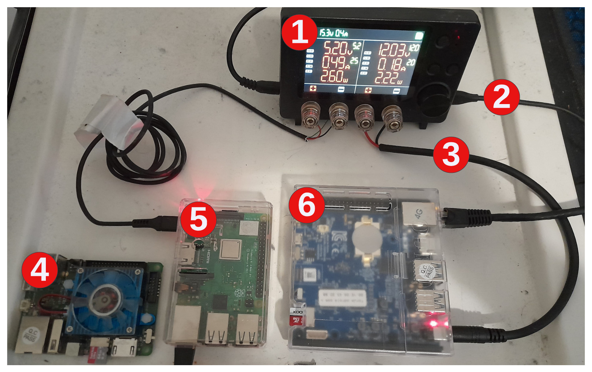

# 🚀 Towards On-Orbit Machine Learning in Picosatellites

**MSci dissertation, University of Glasgow · industry task for [Alba Orbital](http://www.albaorbital.com) · top mark in the year**

📄 [Read the full paper (PDF)](<Towards_On_Orbit_Machine_Learning_in_Picosatellites(Final).pdf>)

Which ML model and hardware should a picosatellite carry? Published on-orbit ML work rarely measured real power, memory or runtime, so there was no way to answer that. This project benchmarks lightweight object detectors across edge boards and accelerators to fill the gap.

<p align="center">
  
  <br>
  <sub>Left: sending all data to Earth wastes bandwidth and power. Right: filtering on board with ML.</sub>
</p>

## Headline result

| Goal | Best setup | mAP50 | Peak power | Peak memory | 100 images |
|---|---|---|---|---|---|
| Power efficiency / memory | YOLOv5n-FP16, Odroid N2+ GPU | 0.897 | 2.43 W | 349 MB | 61.3 s |
| Fastest end to end | YOLOv8n-FP16, Odroid N2+ GPU | 0.896 | 2.48 W | 389 MB | 54.7 s |
| Lowest memory | YOLOv5n on Coral Edge TPU (448×448) | 0.478 | 2.14 W | 70 MB | 50.7 s |

All figures are for the ship-detection models (SHIP dataset). See the paper for the full set.

## What I built

- **Models:** trained YOLOv5n/s and YOLOv8n/s on the [DIOR](https://arxiv.org/abs/1909.00133) remote-sensing dataset (23,463 images, 20 classes) in two versions: all classes and ships only. Converted them from PyTorch to TF-Lite with FP16 and INT8 quantisation, and compiled the INT8 models for the Coral Edge TPU.
- **Hardware:** six test configurations on three boards, working through OS, driver and runtime version conflicts.

  | Board | CPU | Accelerator | Test cases |
  |---|---|---|---|
  | Raspberry Pi 3B+ | 4× A53, 64-bit | Coral USB TPU | TPU (PyCoral), CPU |
  | Odroid XU4 | 4× A15 + 4× A7, 32-bit | none | CPU |
  | Odroid N2+ | 4× A73 + 2× A53, 64-bit | Mali-G52 GPU (ArmNN) | GPU, CPU |

- **Measurement rig:** an Odroid Smart Power 3 logs power at 10+ samples a second. The board signals start and stop over TCP to a separate machine, so logging adds no load to the device under test. Standby power is subtracted, and Wi-Fi and Bluetooth are off.
- **Other measurements:**
  - Memory across the whole process tree (psutil).
  - Wall-clock and CPU time for each stage: initialisation, pre-processing, inference and post-processing.
  - Two efficiency metrics: output tensors per second per watt (inference) and frames per second per watt (full pipeline).

<p align="center">
  
  <br>
  <sub>The power-measurement setup with the three boards.</sub>
</p>

## Findings

- **INT8 suits the CPU and FP16 suits the GPU.** ArmNN's GPU path handles INT8 poorly.
- **YOLOv8 is faster end to end on the GPU even though its inference is slower.** Its anchor-free head outputs 13,125 boxes against YOLOv5's 39,375, so post-processing is much cheaper.
- **The TPU is the most efficient at inference, but only on smaller images.** The model must map entirely onto the TPU, which limits images to 448×448 (ships) or 256×256 (all classes). The Pi 3B+'s slow CPU then becomes the bottleneck in post-processing.
- **A 32-bit CPU cut YOLOv5's FP16 memory use** (Odroid XU4), but did not help YOLOv8.
- **FPGA was planned but not tested.** Vitis AI has dropped support for the PYNQ-Z2's Zynq-7000 chip.

## Repository layout

```
├── models/              Trained models: PyTorch (.pt), TF-Lite FP32/FP16/INT8, Edge TPU
├── scripts/             Model conversion notebooks and dataset configs (YAML)
├── RecordingCode/       On-board benchmark scripts for power, time and memory
├── DataVisulisations/   Notebooks that turn the logs into heatmaps and boxplots
├── assets/              Figures
└── Towards_On_Orbit_Machine_Learning_in_Picosatellites(Final).pdf
```

## Tools

Python · PyTorch · TF-Lite · PyCoral · ArmNN · OpenCV · NumPy · Pandas · psutil · Matplotlib · Seaborn · Linux (Ubuntu, Raspberry Pi OS)

## Acknowledgements

Supervised by Dr Lito Michala, with thanks to Dr Gethin Norman, Dr José Cano Reyes and Alba Orbital.
